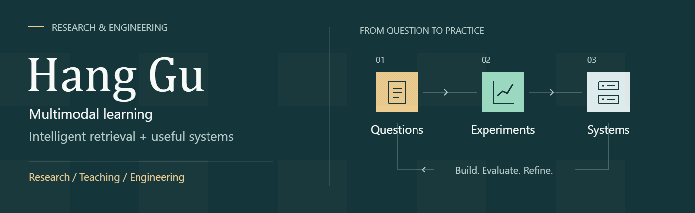

# Hang Gu · 顾航

Lecturer · MSc in Computer Science (Data Science), Universiti Malaya

  <picture>
    <source media="(prefers-reduced-motion: reduce)" srcset="assets/research-still.png" />
    
  </picture>

<a href="assets/research-still.png">静态横幅 / Static banner</a> · <a href="assets/README.md">原创动画 / Behind the animation</a>

  <a href="https://guhang2011.github.io/">Engineering & research portfolio</a> ·
  <a href="https://guhang2011.github.io/#engineering">Engineering highlights</a> ·
  <a href="https://guhang2011.github.io/research/statement.html">Research brief</a> ·
  <a href="https://guhang2011.github.io/research/cv.html">Academic CV</a> ·
  <a href="https://guhang2011.github.io/notebook/">Learning notebook</a> ·
  <a href="mailto:guhang2011@126.com">guhang2011@126.com</a>

I'm **Hang Gu (顾航)**, a lecturer and teaching section director at **江苏财经职业技术学院**, with an MSc in Computer Science (Data Science) from **Universiti Malaya** and a background in frontend engineering.

**Engineering focus:** frontend systems, explicit workflow states, data-quality checks and verifiable delivery. The public cases connect implementation choices with code, interactive demonstrations and scoped verification records.

**Research interests:** reliable multimodal learning with limited labels, frozen vision-language adaptation, validation sensitivity and data artifacts.

这里以工程技术为主：前端交互、工作流状态、数据质量与可复查交付。通过公开代码、项目演示和学习笔记说明设计取舍；同时保留有限标注下的多模态学习与模型评估研究记录。

## Research

| Research question | Approach | Authorship | Status as of September 2026 |
| :--- | :--- | :--- | :--- |
| **FCP · Low-resource multimodal fake-news detection** | Frozen CLIP adaptation, token-level bidirectional co-attention, cosine prototypes and data-artifact analysis | **First author** | Journal resubmission: *International Journal of Machine Learning and Cybernetics* |
| **Validation sensitivity in limited-label news classification** | Model selection and paired validation sampling | Order not stated in CV | Submitted to **DASFAA 2027** |
| **Vision-language multimodal behavior prediction** | VideoMAE, DistilBERT, cross-attention and LSTM temporal modeling | **First author** | Accepted at **ISCAIT 2026** |

Authorship and statuses above follow the September 2026 CV. The October portfolio update does not establish a new publication status or independently recheck experimental results.

My MSc thesis, *Dental Deformities Prediction Using Bayesian Networks among Adolescents*, used R and Bayesian networks to study conditional relationships in clinical data.

[Research brief · Discussion draft](https://guhang2011.github.io/research/statement.html) · [Code & verification evidence](https://guhang2011.github.io/research/#evidence) · [Full academic CV](https://guhang2011.github.io/research/cv.html)

## Selected work

| Work | Focus and scope | Read / verify / try |
| :--- | :--- | :--- |
| **[KICP](https://github.com/GuHang2011/KICP)** · Research | CLIP, learned prompts, co-attention and knowledge retrieval for multimodal fake-news detection | [Code & run requirements](https://github.com/GuHang2011/KICP#readme) |
| **[KAPT](https://github.com/GuHang2011/KAPT)** · Reproducibility learning | Curated **KANO-based** prompt components, validated early stopping and sample-aligned probability ensembles; synthetic examples | [Reading & source attribution](https://github.com/GuHang2011/KAPT/blob/main/REVIEWER_ENTRY.md) · [Reproduction](https://github.com/GuHang2011/KAPT/blob/main/docs/reproduction.md) · [Early-stopping replay](https://guhang2011.github.io/cases/kapt/) |
| **[Silk Road Intelligence](https://guhang2011.github.io/cases/silkroad/)** · Teaching engineering | Cross-border order workflow, stock consistency, permission scopes and simulated fulfillment; adapted from an existing college application | [Screenshot gallery](https://guhang2011.github.io/cases/silkroad/#screenshots) · [Engineering notes](https://github.com/GuHang2011/GuHang2011.github.io/blob/main/cases/silkroad/order-consistency.md) |
| **[Counselor Workflow](https://github.com/GuHang2011/counselor-workflow-showcase)** · Engineering case | Role-based interaction, state transitions, version checks and retry contracts; curated static demonstration | [Architecture & scope](https://github.com/GuHang2011/counselor-workflow-showcase#readme) · [Online demo](https://guhang2011.github.io/counselor-workflow-showcase/) |
| **[Frontend & Data Lab](https://github.com/GuHang2011/frontend-data-lab)** · Learning experiments | Synthetic-data analytics, annotation agreement, bounded crawling and model-evaluation notes | [Reading map](https://github.com/GuHang2011/frontend-data-lab/blob/main/REVIEWER_ENTRY.md) · [Interactive lab](https://guhang2011.github.io/frontend-data-lab/) |

**Reading path:** research question → core code → verification steps and limitations → interactive case. [Model self-study notes](https://github.com/GuHang2011/frontend-data-lab/blob/main/docs/modeling-reading-map.md).

## Engineering highlights / 工程亮点

| Capability | What is visible in the public work |
| :--- | :--- |
| **Interface contracts** | Dynamic forms, role-scoped states, keyboard access, responsive layouts and browser-level checks. |
| **Data quality** | Deterministic cleaning, annotation agreement, quarantine records, CSV/SQLite/JSON hand-offs and bounded crawling. |
| **Model evaluation** | Baselines, validation sensitivity, threshold selection, confusion analysis and sample-aligned prediction ensembles. |
| **Evidence-shaped delivery** | Release gates, artifact hashes, scope notes, synthetic fixtures and explicit “not rerun” boundaries. |

**工程阅读顺序：** 需求问题 → 输入与状态契约 → 核心实现 → 定向检查 → 范围与限制。主页的 [Engineering lens](https://guhang2011.github.io/#engineering) 将这些能力映射到项目案例、在线实验和验证记录。

**18-second project walkthroughs / 项目动画：** [Early stopping · 模型早停](https://guhang2011.github.io/#film-kapt) · [Data quality audit · 数据质量审计](https://guhang2011.github.io/#film-data). Silent animations generated from the demo logic with synthetic data; captions and interactive experiments are available on the site.

The learning lab is a newly assembled educational example. It is separate from employer software and research experiments. KICP contains research code; its README describes the external data and assets required to run it. KAPT preserves KANO source attribution and documents the scope of its component tests.

Earlier coursework / 早期课程练习

- [WQD7006](https://github.com/GuHang2011/WQD7006): historical Python exercises in data collection, regional aggregation and visualization.
- [introdatascience](https://github.com/GuHang2011/introdatascience): early R exercises in extraction, data cleaning and JSON serialization.

丝路智链 · 桌面与手机界面 / Silk Road Intelligence gallery

从既有学院应用改造的跨境订单教学案例，展示中哈合作主题登录、营销审核、订单台账与物流仿真。下列业务界面使用合成教学数据。

<table><tr>
<td></td>
<td></td>
</tr></table>

[完整图集与设计说明](https://guhang2011.github.io/cases/silkroad/) · [状态、库存与幂等笔记](https://github.com/GuHang2011/GuHang2011.github.io/blob/main/cases/silkroad/order-consistency.md)

既有后端报告记录 41 项通过（含共享账户基础测试），本次未重跑。支付与设备为仿真，来源和验证范围详见案例。

## Learning notebook / 学习与项目心得

把代码中的问题整理成可以复查的笔记：为什么这样设计、如何验证、还有什么没有回答。**[在线阅读 9 篇双语笔记](https://guhang2011.github.io/notebook/)**，支持主题筛选、搜索和打印。

| 主题 / Topic | 阅读入口 / Read |
| :--- | :--- |
| 模型学习 | [早停、样本对齐与集成](https://guhang2011.github.io/notebook/model-selection.html) · [提示学习的张量契约](https://guhang2011.github.io/notebook/prompt-contracts.html) |
| 前端与数据 | [双语搜索、焦点与动态效果](https://guhang2011.github.io/notebook/accessible-interactions.html) · [数据清洗的质量契约](https://guhang2011.github.io/notebook/data-quality.html) |
| 项目心得 | [订单幂等与库存一致性](https://guhang2011.github.io/notebook/order-idempotency.html) · [权限边界与可复查交付](https://guhang2011.github.io/notebook/permission-boundaries.html) |
| 生成式模型与工程复现 | [数字人技术路线](https://guhang2011.github.io/notebook/digital-human.html) · [文生图原理与操作](https://guhang2011.github.io/notebook/text-to-image.html) · [版本、提示词与证据链](https://guhang2011.github.io/notebook/generative-workflow.html) |

Compiled from public code and project documents on 19 October 2026, with AI-assisted drafting and translation. Each note separates source observations, teaching examples and proposed checks, with links to evidence; these are not new benchmark results or a historical lab diary.

## Engineering field notes / 工程实践

从本地高校资料归档与协作项目整理的原创笔记，记录设计取舍、验证结果和待完成的工作。附上线、容量测试与个人 AI 接入模板。

[全部 6 篇笔记 / All notes](https://github.com/GuHang2011/engineering-notes) · [官方资料导航 / Official reading](https://github.com/GuHang2011/engineering-notes/blob/main/resources/official-reading.md)

Design decisions, validation and reusable checklists / 设计取舍与验证

| Start with a question | Read / Use |
| :--- | :--- |
| “500 人在线”到底验证了什么？ | [容量复盘](https://github.com/GuHang2011/engineering-notes/blob/main/notes/capacity-testing.md) · [测试报告模板](https://github.com/GuHang2011/engineering-notes/blob/main/templates/capacity-report.md) |
| 每个账号如何使用自己的 AI？ | [密钥与模型接入](https://github.com/GuHang2011/engineering-notes/blob/main/notes/personal-ai-keys.md) · [验收表](https://github.com/GuHang2011/engineering-notes/blob/main/templates/ai-provider-checklist.md) |
| 从开发机到学校服务器还差什么？ | [部署笔记](https://github.com/GuHang2011/engineering-notes/blob/main/notes/campus-system-deployment.md) · [发布检查表](https://github.com/GuHang2011/engineering-notes/blob/main/templates/release-checklist.md) |

These are original notes and reusable checklists, with explicit testing limits. Linked references stay on their official sites; private product code and user data are not published here.

上传系统界面预览 / Upload system preview

来自本地 Edge/WebKit 自动化测试夹具的合成界面截图，仅用于展示布局和功能状态，不包含真实账号、API Key 或用户文件。

<table>
  <tr>
    <td></td>
    <td></td>
    <td></td>
  </tr>
</table>

[查看完整截图目录和说明](https://github.com/GuHang2011/engineering-notes/tree/main/screenshots)

## Engineering & teaching

Applied experience and teaching / 工程与教学经历

- **Intelligent applications:** document parsing, entity extraction, semantic retrieval and RAG workflows.
- **Frontend systems:** Vue / React, TypeScript, dynamic forms, interface contracts, accessibility and performance.
- **Data systems:** Python, R, SQL, Hadoop / Spark, reproducible analysis and visualization.
- **Teaching:** computing courses and practical projects spanning data collection, storage, analysis and presentation.

Recent applied work includes an ongoing AI contract-management project, an ongoing intelligent information-retrieval project, and a completed modular administrative-dashboard project. These are described as experience; their proprietary source code is not part of this profile.

---

Profile updated 19 October 2026. Authorship and research status follow the September 2026 CV; see the <a href="https://guhang2011.github.io/">portfolio</a> for evidence and scope.
