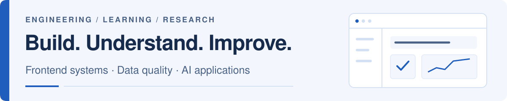

# 顾航 · Hang Gu

高校教师，前端工程背景。马来亚大学计算机科学硕士（数据科学）。

<picture>
  <source media="(prefers-color-scheme: dark)" srcset="assets/profile-cover-dark.svg" />
  
</picture>

**我主要做复杂业务系统的前端开发，关注工作流、数据质量和 AI 应用。** 在这里分享可运行的项目、实现取舍与学习复盘；研究兴趣是资源受限条件下的可靠多模态学习。

**[个人网站](https://guhang2011.github.io/)** · **[在线演示](https://guhang2011.github.io/#demos)** · **[导师阅读入口](https://guhang2011.github.io/research/reviewer-guide.html)**

[简历](https://guhang2011.github.io/research/cv.html) · [项目目录](docs/project-index.md) · [邮件联系](mailto:guhang2011@126.com)

Lecturer at 江苏财经职业技术学院 · MSc, Universiti Malaya. English content is available in the portfolio and notebook.

## 01 / 代表项目

### 沭阳之家 · 多端社区系统

`Vue 3` `Element Plus` `uni-app` `Spring Boot`

将会员、活动、论坛、聊天和文件管理组织成一套多端业务系统。重点看**共享业务状态、角色权限和文件上传恢复**，以及 Web、H5 与小程序之间的适配。

[源码与启动](https://github.com/GuHang2011/shuyang-home) · [项目介绍](https://guhang2011.github.io/cases/shuyang/) · [版本验收记录](https://github.com/GuHang2011/shuyang-home/blob/main/docs/验收记录.md)

本地可运行的试点版本；小程序编译与真机验收分别记录，尚未正式发布。

查看工作台截图

截图来自隔离测试环境。[完整图集](https://github.com/GuHang2011/shuyang-home/tree/main/docs/screenshots)。

### React 工作流 · 审核与异常恢复

`React` `TypeScript` `Ant Design`

把审批过程拆成明确的状态转换，处理**网络重试、版本冲突与重置后的旧请求**。打开演示，先模拟提交失败，再试一次刷新后重新确认。

[打开 Demo](https://guhang2011.github.io/demos/react-workflow/) · [实现与运行说明](https://github.com/GuHang2011/GuHang2011.github.io/tree/main/demos/react-workflow) · [设计复盘](https://guhang2011.github.io/notebook/workflow-recovery-review.html)

AI 辅助实现的独立学习项目，使用合成任务和模拟接口。

查看交互界面

### 禾镜 FieldLens · 图像检测工作台

`JavaScript` `Vite` `Flask` `YOLO 接口`

把图片、检测框、置信度和复核记录放在同一个工作台。打开示例，**调整置信度阈值、查看标注、填写备注并导出记录**，体验模型结果如何进入实际操作流程。

[打开 Demo](https://guhang2011.github.io/fieldlens/) · [源码与本地接入](https://github.com/GuHang2011/fieldlens) · [验证范围](https://github.com/GuHang2011/fieldlens/blob/main/docs/VALIDATION.md)

在线版为合成插画与预设标注，不执行真实推理；本地可接入有授权的 YOLO 检测权重。

查看检测工作台

**更多动手体验：** [配置驱动表单](https://guhang2011.github.io/demos/low-code-form/) · [数据质量实验](https://guhang2011.github.io/demos/data-preparation/) · [多模态决策门控](https://guhang2011.github.io/demos/reliability-gates/)

→ [全部项目与仓库导航](docs/project-index.md)

## 02 / 研究记录

**多模态虚假新闻检测** · 第一作者 · **Neurocomputing 已投稿，尚未录用**  
修订稿重分析 344 次归档训练运行，考察冻结 CLIP 下的融合收益、决策工作点与数据伪线索。[研究解读](https://guhang2011.github.io/research/fusion-audit.html) · [结果重分析代码](https://github.com/GuHang2011/frozen-clip-fake-news-fusion)。公开预测和标签支持指标重算，完整训练与原始划分重建仍需额外材料。

**能源—水系统气候风险** · 第一作者 · **Climate Risk Management 已投稿，尚未录用**  
结合 TFT 与 GNN-CRP，研究中国 30 省 2005—2024 年的时间依赖与跨区域风险传播。[研究介绍](https://guhang2011.github.io/research/climate-risk.html)。当前入口提供摘要与方法说明。

**拟博士研究：** 资源受限条件下的可靠多模态情绪识别，关注预算约束适配、证据不足时的决策，以及持续更新中的遗忘问题。[研究计划（讨论稿）](https://guhang2011.github.io/research/statement.html) · [其他研究与学位论文](docs/project-index.md#research)

## 03 / 最近在整理的笔记

- **[审阅 AI 辅助代码：先复现“旧响应覆盖新输入”](https://guhang2011.github.io/notebook/ai-code-race-review.html)** — 为什么加了防抖，页面仍可能显示过期结果。
- **[审核失败之后：重试、刷新与重置是三条路径](https://guhang2011.github.io/notebook/workflow-recovery-review.html)** — 从失败类型出发设计恢复操作。
- **[导入配置前，为什么必须保住旧表单](https://guhang2011.github.io/notebook/schema-import-review.html)** — 将校验与替换分开，避免错误配置破坏用户输入。

[全部学习笔记](https://guhang2011.github.io/notebook/) · [部署、容量与 AI 接入复盘](https://github.com/GuHang2011/engineering-notes) · [按主题阅读](docs/project-index.md#notes)

笔记依据公开代码和项目记录整理，使用 AI 辅助起草与翻译；教学示例、实际验证和拟开展实验分别说明。

---

内容整理于 2026-11-02。投稿状态依据已提供的信息；项目运行条件、来源和验证范围见各仓库说明。
